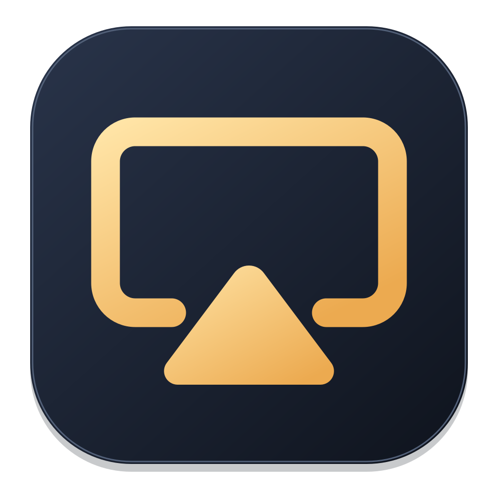

<p align="center"></p>

# Airplay Flixer

Cast web videos from Chrome to Apple TV or a compatible DLNA receiver using a macOS menu bar companion.

[Download the latest release](https://github.com/IndieFear/airplay-flixer/releases/latest) · [Report an issue](https://github.com/IndieFear/airplay-flixer/issues)

## Features

| Category | What you can do |
| --- | --- |
| **Casting** | Detect video streams, choose the quality and cast to an AirPlay or DLNA device on your network. Open the extension from the toolbar or the button over a supported video. |
| **Playback** | Play, pause, seek and stop from Chrome when the receiver supports those controls. See the available resolution and bitrate. The browser video pauses when the TV confirms playback. |
| **Subtitles** | Choose a track for one cast or set a default language. Find tracks on OpenSubtitles or SubDL, adjust the timing, or use local auto-sync on AirPlay. On DLNA, try a separate SRT with automatic burn-in as a fallback. |
| **Downloads** | Save a video to your Mac with the selected external subtitle track as a matching SRT file. |

## Install

1. Extract the release ZIP, move **Airplay Flixer.app** to **Applications** and open it. Allow local network access if prompted.
2. In `chrome://extensions`, enable **Developer mode**, choose **Load unpacked** and select the **Chrome Extension** folder from the ZIP.
3. In **Playback**, choose a device. Pair your Apple TV if prompted, then play a video in Chrome and click **Cast**.

The prebuilt app targets **Apple Silicon with macOS 26 or later**. The Mac and TV must be on the same network. Install FFmpeg with `brew install ffmpeg` for HLS downloads, subtitle synchronization and DLNA burn-in. macOS may ask for approval on first launch. [Apple installation guidance](https://support.apple.com/en-us/102445)

## Build from source

Requires macOS, Python 3.12+, Xcode Command Line Tools and Node.js.

```sh
python3.12 -m venv .venv
.venv/bin/python -m pip install -r requirements-lock.txt
.venv/bin/python scripts/build.py
```

The app, unpacked extension and ZIPs are generated in `dist/`. Run `npm test` and `.venv/bin/python -m unittest discover -s tests` to check the source.
